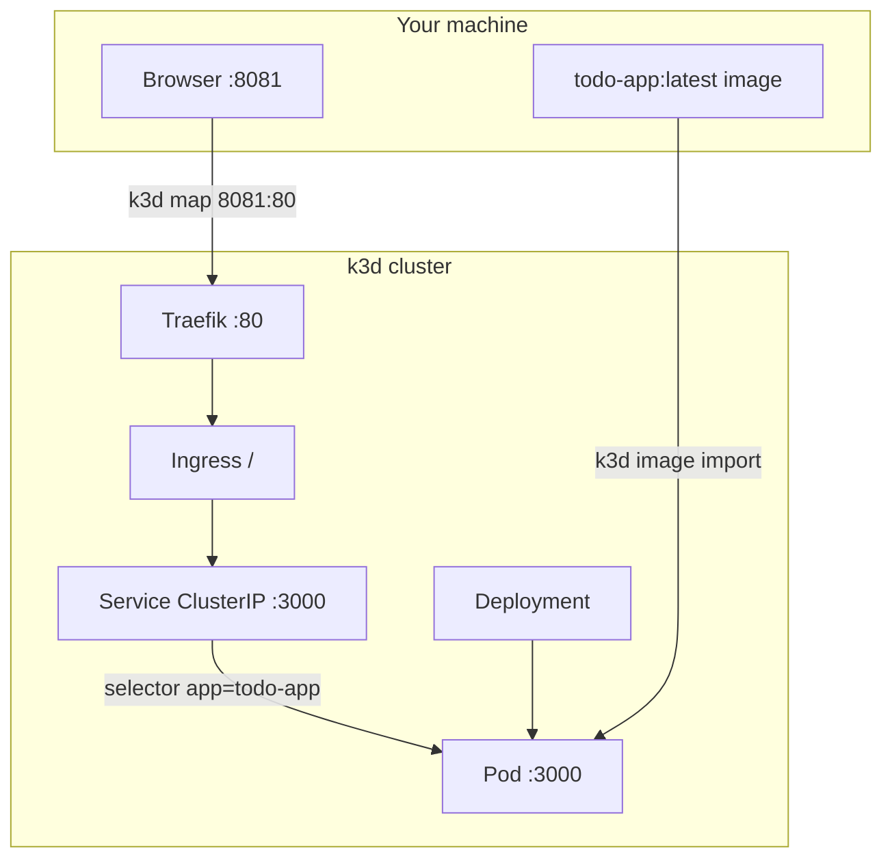
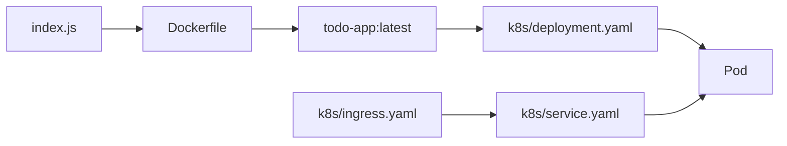
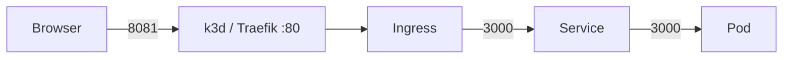

# todo-app

Node + pnpm app on k3d. `PORT` sets the listen port (default `3000`).

- `GET /` — HTML todo page
- `GET /status` — current timestamp + startup random string (in memory)



## Pieces



| File | Role |
| --- | --- |
| `index.js` | HTTP server |
| `package.json` | pnpm `12.14.0`, `pnpm start` |
| `Dockerfile` | `node:26-alpine` + Corepack/pnpm |
| `k8s/deployment.yaml` | 1 replica, `PORT=3000`, resources |
| `k8s/service.yaml` | ClusterIP `:3000` |
| `k8s/ingress.yaml` | Traefik `/` → Service |
| `examples/nodeport-service.yaml` | NodePort example, not in `k8s/` |

## Ports



| Hop | Port |
| --- | --- |
| Browser → host | 8081 |
| k3d load balancer → Traefik | 80 |
| Service → container | 3000 |

`8081` exists because the cluster was created with `-p 8081:80@loadbalancer`.

Optional NodePort (not applied with `kubectl apply -f k8s/`): see [examples/README.md](examples/README.md).

## Run

```bash
docker build -t todo-app:latest .
k3d image import todo-app:latest -c k3s-default
kubectl apply -f k8s/
```

- http://127.0.0.1:8081/
- http://127.0.0.1:8081/status
