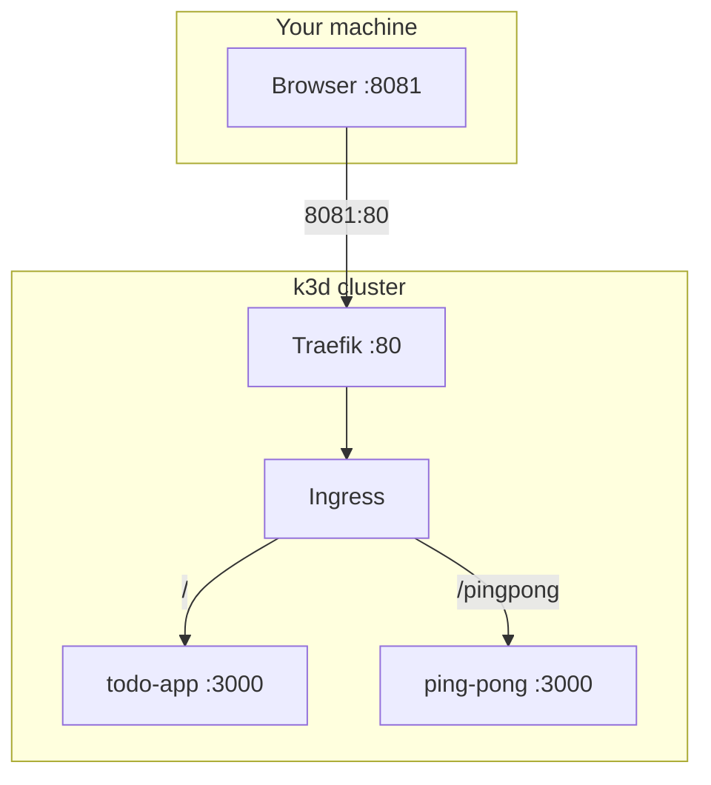

# todo-kubs

pnpm workspace (`apps/*`) with a strict catalog. `PORT` defaults to `3000`.

- `GET /` — todo-app HTML
- `GET /status` — timestamp + startup random string
- `GET /pingpong` — ping-pong `pong N` (in-memory counter)



| Path | App |
| --- | --- |
| `apps/todo-app` | Todo + `/status` |
| `apps/ping-pong` | Counter |
| `k8s/` | Deployments, ClusterIP Services, Ingress |
| `examples/` | NodePort (not applied with `kubectl apply -f k8s/`) |

Shared dependency versions go in `pnpm-workspace.yaml` `catalog` and are referenced as `"catalog:"`.

## Run

```bash
pnpm install
pnpm start:todo-app
pnpm start:ping-pong

docker build -t todo-app:latest ./apps/todo-app
docker build -t ping-pong:latest ./apps/ping-pong
k3d image import todo-app:latest ping-pong:latest -c k3s-default
kubectl apply -f k8s/
```

- http://127.0.0.1:8081/
- http://127.0.0.1:8081/status
- http://127.0.0.1:8081/pingpong
