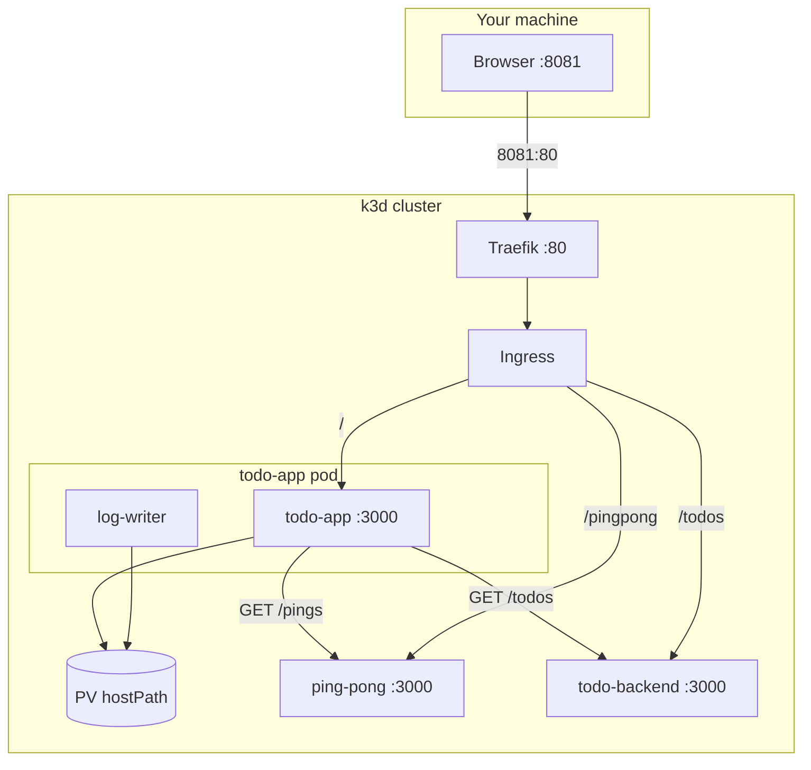

# todo-kubs

pnpm workspace (`apps/*`) with a strict catalog. Fastify apps. `PORT` defaults to `3000`.

- `GET /` — todo UI + Picsum image (todos from todo-backend)
- `GET /todos` / `POST /todos` — in-memory todo API
- `GET /status` — latest log line + ping-pong count (via `GET /pings`)
- `GET /image` — cached Picsum image (10 minutes, one stale serve, then refresh)
- `GET /crash` — exits the HTTP container (image stays on the PV)
- `GET /pingpong` — `pong N`
- `GET /pings` — ping-pong count (todo-app calls this in-cluster)



| Path | App |
| --- | --- |
| `apps/todo-app` | Writer + HTML/image |
| `apps/todo-backend` | In-memory todos |
| `apps/ping-pong` | Counter |
| `k8s/` | App manifests + PVC |
| `k8s/admin/` | PersistentVolume (not applied by `kubectl apply -f k8s/`) |
| `examples/` | NodePort example |

Ping-pong count is in-memory. Todo-app still uses the PV for logs and the image cache.

## Run

```bash
pnpm install
docker build -f apps/todo-app/Dockerfile -t todo-app:latest .
docker build -f apps/todo-backend/Dockerfile -t todo-backend:latest .
docker build -f apps/ping-pong/Dockerfile -t ping-pong:latest .
k3d image import todo-app:latest todo-backend:latest ping-pong:latest -c k3s-default
kubectl apply -f k8s/admin/
kubectl apply -f k8s/
```

- http://127.0.0.1:8081/
- http://127.0.0.1:8081/status
- http://127.0.0.1:8081/pingpong
