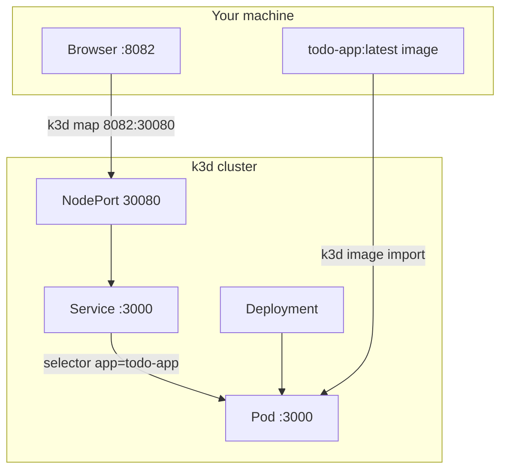
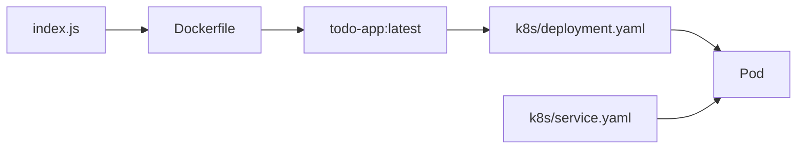
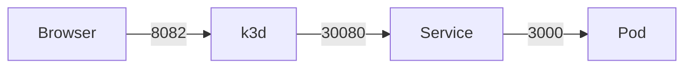

# todo-app

Node + pnpm app on k3d. `PORT` sets the listen port (default `3000`). `GET /` returns a small HTML todo page.



## Pieces



| File | Role |
| --- | --- |
| `index.js` | HTTP server, `GET /` |
| `package.json` | pnpm `12.14.0`, `pnpm start` |
| `Dockerfile` | `node:26-alpine` + Corepack/pnpm |
| `k8s/deployment.yaml` | 1 replica, `PORT=3000`, resources |
| `k8s/service.yaml` | NodePort `30080` → `3000` |

## Ports



| Hop | Port |
| --- | --- |
| Browser → host | 8082 |
| k3d → NodePort | 30080 |
| Service → container | 3000 |

`8082` exists because the cluster was created with `--port 8082:30080@agent:0`.

## Run

```bash
docker build -t todo-app:latest .
k3d image import todo-app:latest -c k3s-default
kubectl apply -f k8s/
```

Open http://127.0.0.1:8082/
