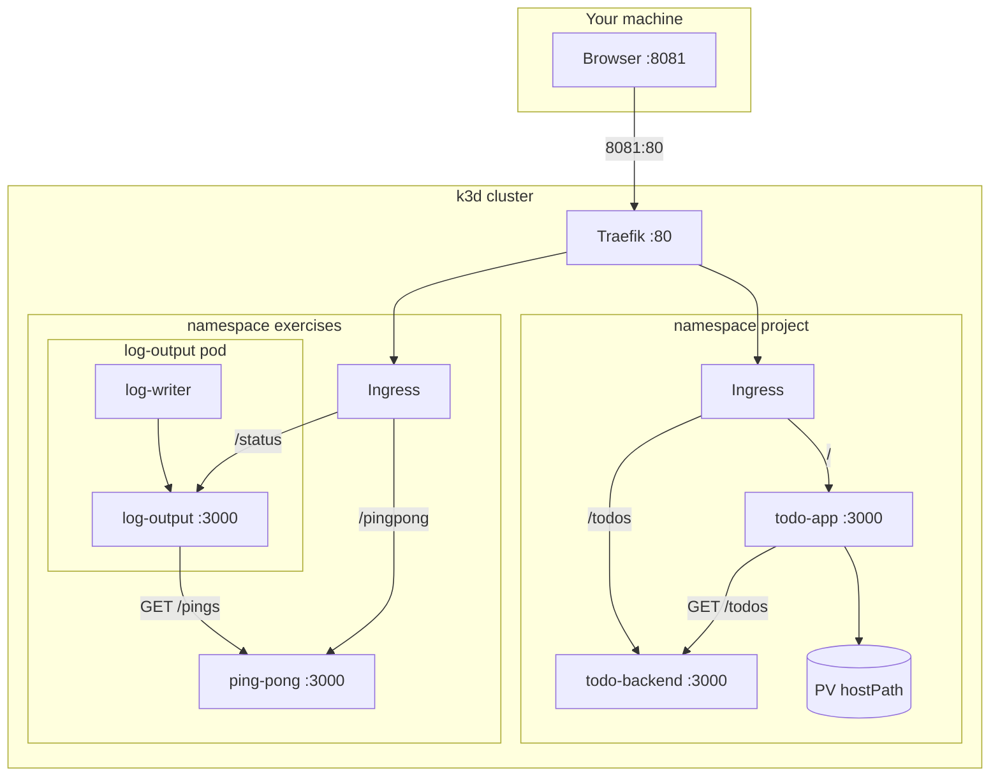

# k8s-hands-on

Kubernetes course work on a local k3d cluster. Apps are Fastify (`PORT` defaults to `3000`) in a pnpm workspace (`apps/*`).

## Cluster

k3s in Docker, Traefik as the Ingress controller, two agent nodes:

```bash
k3d cluster create k3s-default \
  --port 8081:80@loadbalancer \
  --port 8082:30080@agent:0 \
  --agents 2
```

| Host | Cluster | Why |
| --- | --- | --- |
| `8081` | Traefik `:80` | Ingress |
| `8082` | NodePort `30080` | Old access, see `examples/` |

`kubectl apply -f k8s/` is not recursive. Apply namespaces before the rest of each folder.

## Namespaces

| Namespace | For |
| --- | --- |
| `exercises` | Course apps (log-output, ping-pong) |
| `project` | Todo app |
| default | Unused; course material can still use it |

## Ingress, storage, pods

Two Ingress objects (one per namespace) share Traefik. More specific paths (`/pingpong`, `/status`, `/todos`) win over `/`.

- **PV / PVC** — cluster-scoped hostPath PV in `k8s/admin/` (`Retain`, class `manual`). Claim `shared-data` is in `project` for the Picsum cache. Recreate the PV if a deleted claim leaves it `Released`.
- **emptyDir** — log-output writer and reader share a file in the same pod.
- **ClusterIP** — in-namespace DNS (`http://ping-pong:3000`, `http://todo-backend:3000`).



| Path | What |
| --- | --- |
| `k8s/admin/` | PersistentVolume |
| `k8s/exercises/` | Namespace, log-output, ping-pong, Ingress |
| `k8s/project/` | Namespace, todo apps, PVC, Ingress |
| `examples/` | NodePort Service |

## Apps

| Path | Role | Namespace |
| --- | --- | --- |
| `apps/log-output` | Writer every 5s + `GET /status` | `exercises` |
| `apps/ping-pong` | In-memory `pong N` + `GET /pings` | `exercises` |
| `apps/todo-app` | HTML + cached image | `project` |
| `apps/todo-backend` | In-memory `GET`/`POST /todos` | `project` |

- `GET /` — todo UI
- `GET /todos` / `POST /todos` — todo API
- `GET /image` — Picsum, 10 minute cache, one stale serve, then refresh
- `GET /crash` — exit the todo-app container (image stays on the PV)
- `GET /status` — last log line + `Ping / Pongs: N`
- `GET /pingpong` — `pong N`

## Run

```bash
pnpm install
docker build -f apps/log-output/Dockerfile -t log-output:latest .
docker build -f apps/ping-pong/Dockerfile -t ping-pong:latest .
docker build -f apps/todo-app/Dockerfile -t todo-app:latest .
docker build -f apps/todo-backend/Dockerfile -t todo-backend:latest .
k3d image import log-output:latest ping-pong:latest todo-app:latest todo-backend:latest -c k3s-default
kubectl apply -f k8s/admin/
kubectl apply -f k8s/exercises/namespace.yaml -f k8s/project/namespace.yaml
kubectl apply -f k8s/exercises/ -f k8s/project/
```

- http://127.0.0.1:8081/
- http://127.0.0.1:8081/status
- http://127.0.0.1:8081/pingpong
