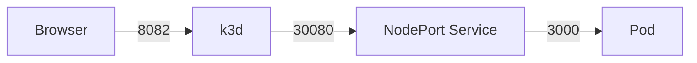
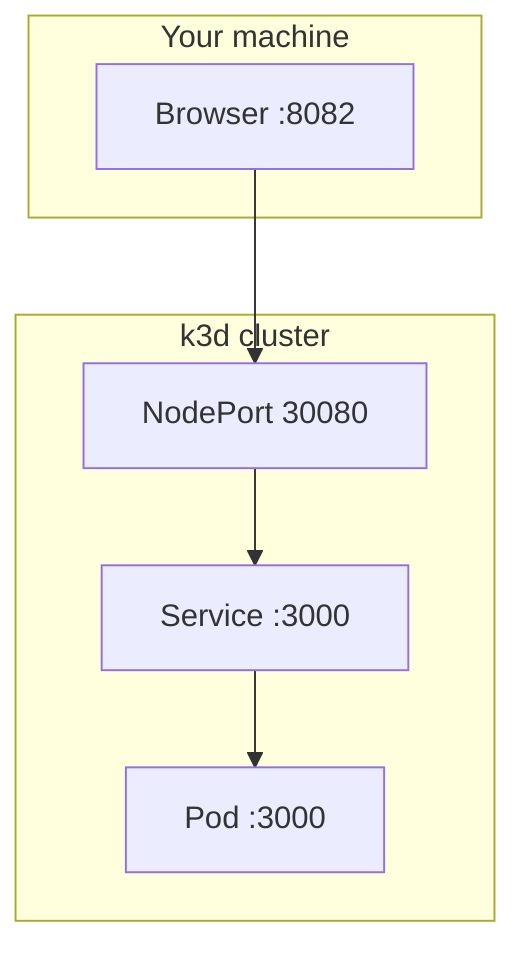

# NodePort (old access)

This folder is not applied with the app manifests.

Before Ingress, the app was reached through a NodePort Service. k3d mapped host **8082** to NodePort **30080**.



| Hop | Port |
| --- | --- |
| Browser → host | 8082 |
| k3d → NodePort | 30080 |
| Service → container | 3000 |

Set by cluster create:

```text
--port 8082:30080@agent:0
```



## Apply

The Deployment (and ClusterIP Service) must already exist in the `project` namespace.

```bash
kubectl apply -f examples/nodeport-service.yaml
```

Open http://127.0.0.1:8082/

This Service is named `todo-app-nodeport` so it can sit beside the ClusterIP `todo-app` Service used by Ingress.
